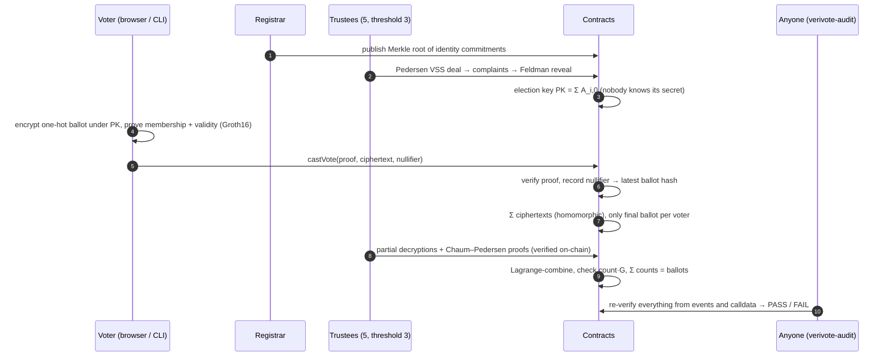

<div align="center">

# 🗳️ VeriVote

### End-to-end verifiable voting on Ethereum
**Zero-knowledge eligibility · threshold homomorphic tallying · anyone can audit the result**


</div>

---

VeriVote is a voting protocol where **the server is not trusted for anything**. The cryptography and the
smart contracts enforce every guarantee, and a single command lets anyone re-check an election from public chain data:

| Guarantee | How it is enforced |
|---|---|
| **One eligible voter, one vote** | A Groth16 proof of membership in the voter roll (Poseidon Merkle tree) plus a nullifier `Poseidon(sk, electionId)` checked on-chain |
| **Ballot secrecy** | Each ballot is encrypted with exponential ElGamal under a key that **no single party holds**: it comes from a 3-of-5 distributed key generation |
| **Valid ballots only** | The same proof shows the ciphertext encrypts a one-hot vote (exactly one candidate) |
| **Individual verifiability** | Every voter gets a receipt and can check that their ballot is the one counted. A Benaloh *cast-or-audit* challenge catches a dishonest voting client |
| **Universal verifiability** | `verivote-audit` downloads everything and re-verifies every proof, the aggregation, every decryption proof and the final count. It prints **PASS/FAIL** |
| **Coercion mitigation** | Re-voting with *last vote counts*. The [threat model](docs/THREAT_MODEL.md) states exactly what this does **not** resist |

---

## ✅ It works end to end

A complete election on a local chain: 20 voters, 4 of whom re-voted, five trustees with threshold three, then
an independent audit of the result.

```text
$ pnpm --filter @verivote/load-test demo -- --voters 20

election 1597…  at 0x8f3C…
roll published: 20 commitments
DKG finalized: 3-of-5
24 ballots cast (4 re-votes)

Result
  candidate 1: 6 (expected 6)
  candidate 2: 5 (expected 5)
  candidate 3: 9 (expected 9)

Audit verdict: PASS
  [PASS] On-chain Groth16 verifier matches the published verification key
  [PASS] Voter roll: every root recomputed from the published commitments
  [PASS] Distributed key generation: public key recomputed from qualified dealers
  [PASS] Ballots: every Groth16 proof and ballot commitment re-verified
  [PASS] Homomorphic aggregation: encrypted tally recomputed from final ballots
  [PASS] Trustee partial decryptions: Chaum–Pedersen proofs re-verified
  [PASS] Result: counts recomputed by threshold decryption and discrete log
```

---

## 🏗️ How it works



### The ballot circuit

One Circom circuit proves all of this at once. It is shipped for `K = 4` and `K = 8` candidate slots:

```
Poseidon(sk) ∈ MerkleTree(root)                    ← eligible, without revealing which voter
nullifier = Poseidon(sk, electionId)               ← one vote per voter, unlinkable across elections
m ∈ {0,1}^K,  Σ m = 1,  m_i = 0 for inactive slots ← valid one-hot ballot
c_i = (r_i·G, m_i·G + r_i·PK)  on Baby Jubjub      ← ciphertext bound to the proof
voteIndex public                                    ← re-votes ordered, replay impossible
```

| Circuit | Constraints | Public signals | Proof time (Node 24, desktop) |
|---|---:|---:|---:|
| `Ballot(4, 20)` | 17,673 | 23 | 1.33 s |
| `Ballot(8, 20)` | 30,049 | 39 | 1.54 s |

### Trustless tally

Ballots are summed **while still encrypted**. Trustees never see an individual ballot. Each of at least three
trustees publishes `D_j = s_j · ΣC1` together with a Chaum–Pedersen proof that it used its real key share. The
contract verifies every proof, Lagrange-combines the shares, and accepts a count only if `count·G` equals the
decrypted point. A final check requires the counts to sum to the number of voters.

---

## 🔐 Security engineering

| Layer | What was done | Result |
|---|---|---|
| **Unit + integration** | Full elections in Foundry with **real** Groth16 proofs, a real DKG transcript and real Chaum–Pedersen proofs | 102 tests pass |
| **Invariant fuzzing** | A random mix of votes, replays, pauses, time jumps and tallies | tally = distinct voters · no nullifier reuse · phases monotonic · pause can't change results |
| **Property fuzzing** | Flip any public signal or proof word; pause at any time for any duration | always rejected · voting extended exactly |
| **Formal (Halmos)** | Symbolic execution over all inputs | **5/5 specifications proven** ([results](contracts/test/formal/RESULTS.md)) |
| **Static analysis** | Slither with the CI gate failing on medium or higher | 0 high · 0 medium |
| **Cross-implementation** | Solidity curve, Chaum–Pedersen and Lagrange code checked against the TypeScript reference | vectors match |
| **Defence in depth** | A deliberately broken verifier that accepts a two-candidate vote | the tally still refuses to finalize |
| **Coverage** | `forge coverage` | 98.9% branches · 100% functions |

**Bugs found and fixed by this process** (full write-ups in the [security review](docs/AUDIT_REPORT.md)):

- 🔴 A malformed proof made the pairing precompile burn the caller's **entire gas limit** (~1,000,000,000 gas in a test). Gas forwarded to the verifier is now capped.
- 🟠 Return-data bomb on the verifier call. The contract now copies exactly one word.
- ⚡ Baby Jubjub scalar multiplication rewritten as stack-only assembly: **487,956 → 310,862 gas**.

### Gas (measured)

| Operation | Gas |
|---|---:|
| Cast a vote, 4 candidates (execution) | **375,527** |
| Re-vote, 4 candidates | 353,101 |
| Cast a vote, 8 candidates | 487,790 |
| Full `castVote` transaction (avg. over a live election) | 428,297 |
| Aggregation per ballot | ≈ 78,000 |

Full breakdown: [`contracts/GAS_REPORT.md`](contracts/GAS_REPORT.md).

### Honest limits

- **Receipt-freeness is not provided.** A voter can prove how they voted by revealing their randomness. Re-voting defeats a coercer who only watches the moment of casting, nothing more.
- **Three or more colluding trustees** can decrypt individual ballots. They still cannot link a ballot to a voter or change the count.
- **The registrar's root is not recomputed on-chain**, because that would cost about 0.5M gas per voter. A dishonest root is always *detected* by `verivote-audit`, but it is not *prevented*.
- **The committed proving keys are for development.** A real deployment must first run the multi-party ceremony (`circuits/scripts/ceremony.sh`).
- The security review in `docs/` was written by the author. It is **not** an independent third-party audit.

---

## 🚀 Quickstart

Requirements: Node ≥ 22, pnpm 10, [Foundry](https://getfoundry.sh), [circom 2.2](https://docs.circom.io).

```bash
pnpm install
```

```bash
pnpm --filter @verivote/circuits build && pnpm --filter @verivote/circuits dev-keys
```

```bash
anvil --block-time 1
```

In a second terminal, deploy and run a full election with 5 trustees and 100 voters, followed by the audit:

```bash
cd contracts && DEPLOYMENT_NAME=local SAFE_ADDRESS=0x70997970C51812dc3A010C7d01b50e0d17dc79C8 TIMELOCK_DELAY=60 forge script script/Deploy.s.sol --rpc-url http://127.0.0.1:8545 --broadcast --private-key 0xac0974bec39a17e36ba4a6b4d238ff944bacb478cbed5efcae784d7bf4f2ff80
```

```bash
pnpm -r --filter "./packages/*" --filter "./services/*" --filter "./tools/*" build && pnpm --filter @verivote/load-test demo
```

The key above is Anvil's public development key. Never use it on a real network.

Re-check any election yourself:

```bash
node tools/verivote-audit/dist/cli.js election --election <id> --deployment contracts/deployments/local.json
```

---

## 🗂️ Repository

```
circuits/            Circom ballot circuit, ceremony + dev-key scripts, witness/proof/negative tests
contracts/           Foundry: Election, Factory, VoterRegistry, TrusteeCoordinator, Tally, curve libraries
  test/              unit · integration · fuzz · invariant · formal (Halmos) · gas budgets
packages/crypto-core TypeScript reference crypto: Baby Jubjub, Poseidon tree, ElGamal, DKG, Chaum–Pedersen
packages/sdk         typed ABIs + full election reconstruction from chain events
services/trustee-cli Argon2id-encrypted keystore, optional PKCS#11/YubiKey wrapping, DKG + decryption
tools/verivote-audit universal verifiability CLI (PASS/FAIL)
tools/load-test      end-to-end election runner and demo
docs/                protocol spec · architecture (C4 + sequences) · threat model · security review
```

## 📚 Documentation

- [Protocol specification](docs/PROTOCOL.md): every equation, encoding and phase rule
- [Architecture](docs/ARCHITECTURE.md): C4 diagrams, sequence diagrams, and why Groth16 over PLONK/STARKs
- [Threat model](docs/THREAT_MODEL.md): STRIDE plus voting-specific threats, each mapped to code or marked "not mitigated"
- [Security review](docs/AUDIT_REPORT.md): 16 findings with severity, fix and verification

## 🛣️ Status

| Component | State |
|---|---|
| Ballot circuits, ceremony scripts | ✅ done, tested |
| Smart contracts + full test / fuzz / invariant / formal suite | ✅ done |
| Trustee client, audit CLI, SDK, end-to-end runner | ✅ done |
| Relayer (gas abstraction), registrar service, indexer | 🚧 next |
| Voter / admin / explorer web apps (Next.js) | 🚧 planned |
| Docker / Helm / Terraform, CI/CD, observability, 10k-voter load test | 🚧 planned |
| Public testnet deployment | ⏳ needs funded deployer key + multisig |

---

<div align="center">

Designed & built by **lumidren** · MIT License

</div>
