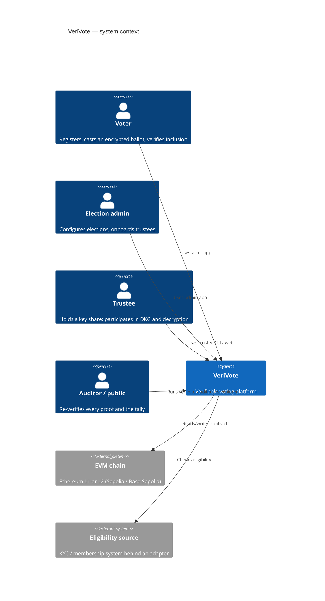
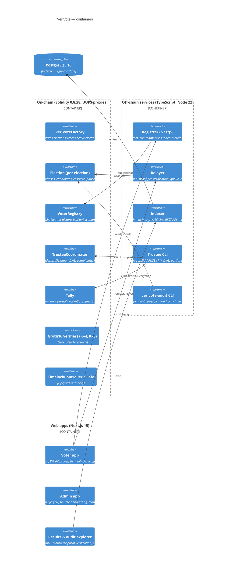

# VeriVote Architecture

## 1. System context (C4 level 1)



## 2. Containers (C4 level 2)



## 3. Components (C4 level 3) — crypto core

`packages/crypto-core` is the single implementation of every primitive used off-chain, shared by services,
CLIs and browsers (pure TypeScript + `circomlibjs` for Poseidon/Baby Jubjub field ops, `snarkjs` for proofs):

| Module | Responsibility |
|---|---|
| `babyjub.ts` | Curve arithmetic (affine + projective), `H` derivation, subgroup checks, scalar encoding |
| `poseidon.ts` | Poseidon wrappers matching circomlib parameters |
| `merkle.ts` | Append-only Poseidon Merkle tree (depth 20), proofs, root recomputation from events |
| `identity.ts` | `sk` sampling, commitment, nullifier |
| `elgamal.ts` | Exponential ElGamal, homomorphic add, BSGS discrete log |
| `ballot.ts` | Ballot encoding, hashing, Benaloh audit records |
| `prover.ts` | snarkjs wrapper with progress callbacks; public-signal (de)serialisation |
| `dkg.ts` | Polynomials, Pedersen/Feldman commitments, share ECIES, verification, share combination |
| `chaum-pedersen.ts` | Partial decryption proofs (keccak Fiat–Shamir matching the contract) |
| `lagrange.ts` | Lagrange coefficients mod `l` |
| `encoding.ts` | ABI-compatible encodings for all on-chain structs |

## 4. Protocol sequences

### 4.1 Registration

```mermaid
sequenceDiagram
  participant V as Voter app
  participant R as Registrar
  participant A as Eligibility adapter
  participant C as VoterRegistry
  V->>V: sk ←$ F_p ; idc = Poseidon(sk) (stored encrypted locally)
  V->>R: POST /register {credential, idc}
  R->>A: check(credential)
  A-->>R: eligible / not eligible
  R->>R: append idc to tree; append to hash-chained audit log
  R-->>V: {leafIndex, auditEntryHash}
  R->>C: publishRoot(electionId, root, leaves[], leafCount)   (batched)
  C-->>R: RootPublished, LeavesAppended events
  V->>C: (later) read LeavesAppended events, rebuild tree, compute own path
```

### 4.2 Distributed key generation

```mermaid
sequenceDiagram
  participant Ti as Trustee i (CLI)
  participant Tj as Trustee j (CLI)
  participant K as TrusteeCoordinator
  Ti->>K: registerKey(EK_i)
  Tj->>K: registerKey(EK_j)
  Ti->>K: deal(C_i,*, enc_j(s_ij, s'_ij) ∀j)
  Tj->>K: read SharesDelivered; decrypt; verify Pedersen equation
  alt share invalid
    Tj->>K: complain(i)
    Ti->>K: justify(j, s_ij, s'_ij)  (verified on-chain, else i disqualified)
  end
  Ti->>K: reveal(A_i,*)   (after complaintDeadline; QUAL fixed)
  Tj->>K: read Reveals; verify Feldman equation
  alt Feldman check fails
    Tj->>K: exposeReveal(i, s_ij, s'_ij) → DKG Failed
  end
  Tj->>K: finalize()  → PK = Σ A_i,0 ; Ck_k = Σ A_i,k
  Tj->>Tj: s_j = Σ s_ij (stored encrypted)
```

### 4.3 Voting

```mermaid
sequenceDiagram
  participant V as Voter app (Web Worker prover)
  participant Rl as Relayer
  participant E as Election
  participant Vf as Verifier
  V->>V: build Merkle path locally from on-chain leaves
  V->>V: encrypt ballot (m, r) → (c1, c2); show ballotHash
  alt Benaloh audit
    V->>V: reveal (m, r); voter re-encrypts with verivote-audit; discard
  end
  V->>V: Groth16 prove (progress UI)
  V->>Rl: POST /relay {election, proof, publicSignals}
  Rl->>Rl: verify proof locally (reject invalid); enqueue
  Rl->>E: castVote(proof, publicSignals)
  E->>Vf: verifyProof
  E->>E: record[nullifier] = (hash, count+1); emit BallotCast
  Rl-->>V: {txHash}; receipt = (nullifier, voteIndex, ballotHash, txHash)
  V->>E: verify-my-vote: find BallotCast(nullifier), compare hash
```

### 4.4 Tally

```mermaid
sequenceDiagram
  participant Any as Anyone (aggregator)
  participant T as Tally
  participant Tj as Trustee j
  participant Au as verivote-audit
  Any->>T: aggregate(electionId, ballots[] sorted by nullifier)   (batches)
  T->>T: check hash vs Election.record; add ciphertexts (projective)
  Any->>T: normalize() once aggregatedCount == ballotCount
  Tj->>T: submitPartialDecryption(D_j,*, CP proofs)
  T->>T: verify Chaum–Pedersen for every slot
  Any->>T: finalizeSlot(i, count_i, trusteeSubset)  (count via BSGS off-chain)
  T->>T: λ_j, X_i = Σ λ_j D_j,i ; M_i = C2_i − X_i ; count_i·G == M_i
  T->>T: all slots done → Σ counts == ballotCount → Finalized
  Au->>T: recompute everything from events; PASS/FAIL
```

## 5. Circuits

| Circuit | Purpose | Public inputs | Constraints (non-linear) | Proving key size |
|---|---|---|---|---|
| `Ballot(4, 20)` | Membership + nullifier + one-hot ElGamal ballot, 4 slots | 23 | TBD-MEASURE | TBD-MEASURE |
| `Ballot(8, 20)` | Same, 8 slots | 39 | TBD-MEASURE | TBD-MEASURE |

Constraint budget by component (K = 4): Merkle path (20 × Poseidon₂) ≈ 4.9k; nullifier + commitment ≈ 0.5k;
per slot: `EscalarMulFix` (r·G) + `EscalarMulAny` (r·PK) + boolean point select + `BabyAdd` ≈ 6.6k.
Measured values are produced by `circuits/scripts/constraint-report.mjs` and regression-checked in CI
(`circuits/constraints.json`).

### 5.1 Why Groth16 (and why a ceremony)

| Option | Proof size | Verify gas (23 inputs) | Setup | Phone prover |
|---|---|---|---|---|
| **Groth16 (chosen)** | 3 group elements (256 B) | ≈ 200k + 6.2k/input | circuit-specific phase 2 | best (snarkjs, WASM) |
| PLONK + KZG | ≈ 1 KB | ≈ 300–350k | universal (still a ceremony) | ≈ 3–5× slower in snarkjs |
| STARK (e.g. Stone/Winterfell) | 50–200 KB | ≈ 1–3M | transparent | no mature browser prover for Circom-style circuits |

Per-vote gas is the dominant cost of a public election, and the phone prover is the dominant UX constraint,
so Groth16 wins on both. The trusted-setup risk is bounded: phase 1 reuses the Perpetual Powers of Tau
(thousands of contributors), and phase 2 is scripted with contribution verification
(`circuits/scripts/ceremony.sh`); a single honest contributor suffices. The verifier contract is derived from
the final zkey in CI and compared with the committed artifact.

## 6. Contracts

```
contracts/src/
  VeriVoteFactory.sol      UUPS. createElection(); activeElections counter; verifier registry by K
  Election.sol             UUPS (per election). phases, schedule, candidates, castVote, pause w/ extension
  VoterRegistry.sol        UUPS singleton keyed by electionId. root history, LeavesAppended
  TrusteeCoordinator.sol   UUPS singleton. trustees, Pedersen deal, complaints, Feldman reveal, finalize
  Tally.sol                UUPS singleton. aggregate, normalize, partial decryptions, finalizeSlot
  verifiers/Groth16Verifier4.sol, Groth16Verifier8.sol   generated
  libraries/BabyJubJub.sol     extended twisted Edwards arithmetic, scalar mul, subgroup check
  libraries/ChaumPedersen.sol  on-chain CP verification
  libraries/Lagrange.sol       coefficients mod l
  interfaces/*.sol
```

Storage is packed (`record[nullifier]` is one slot: 224-bit hash + 32-bit count; phase/flags/timestamps packed
in one slot). All external inputs are `calldata`. Custom errors everywhere. Gas report in `contracts/GAS_REPORT.md`.

## 7. Services

* **Registrar** (NestJS): `EligibilityAdapter` interface with `DemoAdapter` (CSV allow-list + one-time codes) and
  `HttpKycAdapter` (signed webhook); `IdentityService` issues leaves; `MerkleService` builds the tree and
  publishes roots in batches; `AuditLogService` keeps an append-only, hash-chained log with a public
  `/audit/log` endpoint and `verivote-audit` verification.
* **Relayer**: stateless HTTP + in-memory/Redis queue, off-chain Groth16 pre-verification, per-IP rate limits,
  nonce management, resubmission until `confirmations`, metrics `verivote_relayer_queue_depth`,
  `verivote_relayer_failures_total`.
* **Indexer**: viem log streaming with reorg detection (block-hash chain), idempotent upserts into Postgres (SQLite
  for local dev via `node:sqlite`), REST API consumed by the apps.
* **Trustee CLI**: `keygen`, `register`, `deal`, `verify-shares`, `complain`, `justify`, `reveal`, `finalize`,
  `partial-decrypt`, `decrypt-count`; keystore backends `file` (Argon2id + AES-256-GCM) and `pkcs11` (HSM/YubiKey
  wraps the share with a non-exportable AES key).
* **verivote-audit**: downloads all events for an election and re-verifies: roll root, every Groth16 proof,
  aggregation, every Chaum–Pedersen proof, Lagrange reconstruction, `count·G == M`, `Σ counts == ballots`.
  Prints PASS/FAIL per check.

## 8. Data flow and trust boundaries

* `sk` never leaves the voter device.
* Trustee shares never leave the trustee machine unencrypted.
* The relayer sees proofs and ciphertexts (public data) and the voter's IP; it is deployed behind a WAF and
  logs no bodies.
* The indexer and explorer are convenience layers; nothing they serve is trusted by `verivote-audit`.

## 9. Deployment topology

Local: `docker compose up` starts Anvil, Postgres, registrar, relayer, indexer, the three apps, Prometheus,
Grafana and an OTel collector. Kubernetes: Helm chart `infra/helm/verivote` (one Deployment per service, HPA,
PDB, NetworkPolicy, ServiceMonitor). AWS: Terraform in `infra/terraform` (VPC, EKS, RDS Postgres 16, S3 for
circuit artifacts, ALB + WAF, CloudWatch log groups and alarms).
